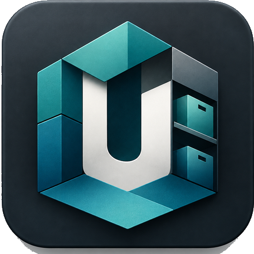
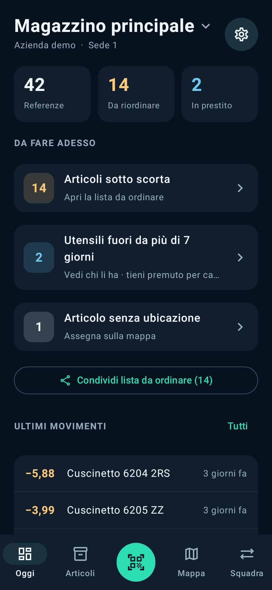
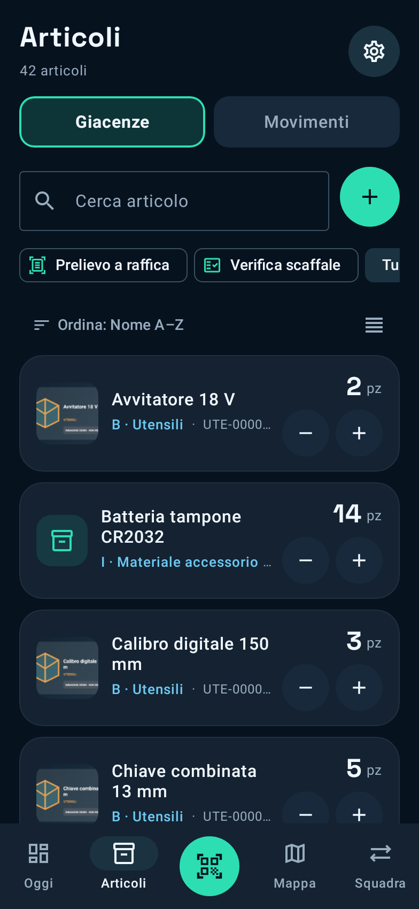
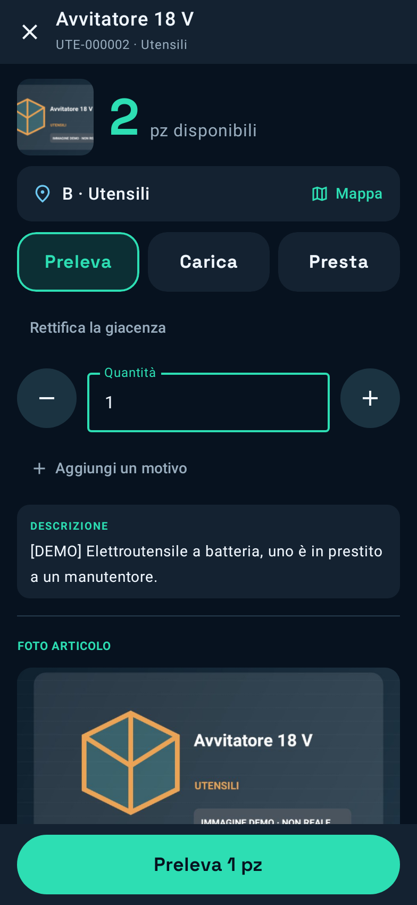
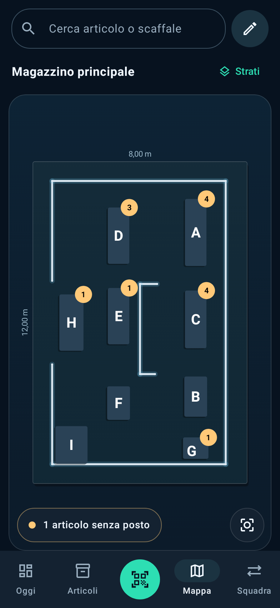
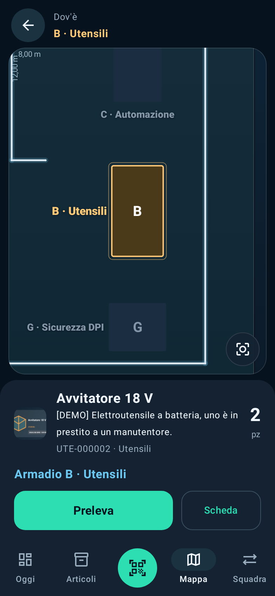
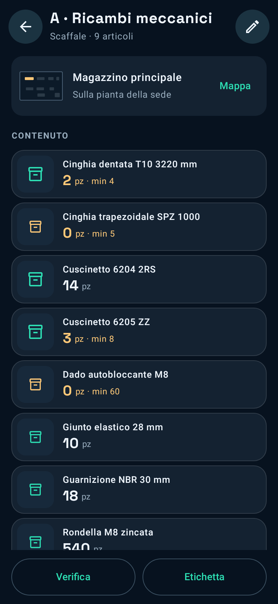
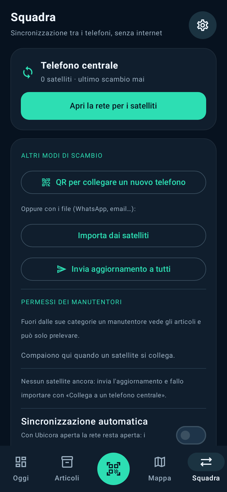
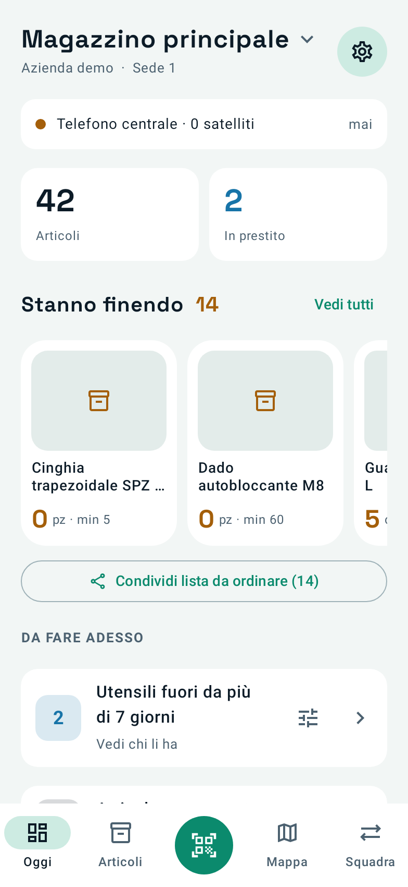
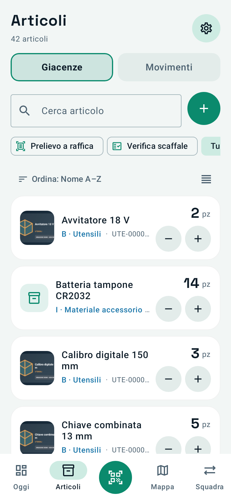

# Ubicora

**Inventario, ubicazioni e mappa del magazzino — sul telefono, senza cloud, anche in squadra.**

[📖 Guida illustrata (PDF, ferma alla 4.12)](docs/guida/Ubicora_Guida_4.12.pdf) · [🆕 Novità](docs/CHANGELOG.md) · [⬇️ Installare e aggiornare](#installare-e-aggiornare) · [🌐 Versione Web](web/README.md)

  
  
  
  
  

  
  
  
  
  

> Schermate della 4.26.0 con il magazzino dimostrativo. Si rifanno da sole con **Actions → Schermate → Run workflow** (escono sul ramo `schermate-output`); il prelievo a raffica non c'è perché la fotocamera si vede solo su un telefono vero.

## Novità dalla 4.21 alla 4.26

| | Novità | In breve |
|---|---|---|
| 🧭 | **Ordine sullo schermo** (4.26) | Scheda articolo con foto e quantità in alto, righe di Articoli più basse, Oggi senza doppioni, mappa con le sole lettere a riposo, Squadra con un solo primo passo |
| 🧱 | **Solidità** (4.25) | Un solo archivio per tutta l'app, database alla versione 13 con migrazione tutto-o-niente, una sola regola per la giacenza, trasferimenti tra sedi tutto-o-niente |
| 🛡️ | **Satelliti protetti** (4.25) | Se il centrale ripristina un backup vecchio, il satellite non cancella nulla e mostra un conflitto da controllare |
| 💾 | **Backup senza limiti** (4.24.1) | Nessun limite di righe, ripristino una riga alla volta; un satellite ripristinato continua a inviare al centrale |
| 🖼️ | **Stile «Vetrina»** (4.24) | Gli articoli che finiscono sono schede con la foto; giacenza in grande, pulsanti Preleva/Carica/Presta grandi, «Aggiungine un altro» |
| 🗺️ | **Mappa più chiara** (4.23) | Un solo colore, la lettera dentro lo scaffale, pallino giallo con gli articoli che finiscono |
| 🧹 | **Movimenti vecchi** (4.22) | Cancella i movimenti con più di 2 anni senza toccare le giacenze |
| 🔎 | **Ricerca per descrizione** (4.21) | Tutte le ricerche degli articoli guardano anche la descrizione, con più parole insieme |
| 🛠️ | **Manutentore con reparto** (4.21) | Modifica le schede degli articoli del suo reparto; il centrale **valida** o **rimanda indietro** con una nota |
| ➕ | **Nuovo articolo in tre passi** (4.21) | Foto, nome e categoria con gli articoli simili da copiare, quantità e ubicazione (dalla 4.25 con la piantina della sede) |

> ⚠️ Un database aperto dalla 4.25 non si apre più con un'app più vecchia: fai un backup completo prima di aggiornare.

Dettagli: [4.21](docs/CHANGELOG_4_21_0.md) · [4.21.1](docs/CHANGELOG_4_21_1.md) · [4.21.2](docs/CHANGELOG_4_21_2.md) · [4.22](docs/CHANGELOG_4_22_0.md) · [4.23](docs/CHANGELOG_4_23_0.md) · [4.24](docs/CHANGELOG_4_24_0.md) · [4.24.1](docs/CHANGELOG_4_24_1.md) · [4.25](docs/CHANGELOG_4_25_0.md) · [4.26](docs/CHANGELOG_4_26_0.md) · [4.26.1](docs/CHANGELOG_4_26_1.md)

## Novità dalla 4.17 alla 4.20

| | Novità | In breve |
|---|---|---|
| 🏢 | **Azienda con più sedi** (4.17) | Si sceglie l'azienda e poi la sede; la ricerca guarda anche nelle altre sedi e le etichette portano alla sede giusta |
| 👥 | **Squadra su tutte le sedi** (4.18) | Con un solo collegamento i satelliti lavorano su tutte le sedi condivise dal centrale |
| 🔀 | **Trasferimenti tra sedi** (4.19) | «Sposta in un'altra sede…»: i pezzi escono da una sede ed entrano nell'altra nello stesso momento |
| 🔐 | **Permessi dei satelliti** (4.19) | Tre livelli assegnati dal centrale: Solo prelievo, Operatore di reparto, Manutentore |
| 📷 | **Scanner nuovo** (4.19.3) | Dentro l'app, con cornice, torcia e indicazioni; dialoghi e menu con i colori di Ubicora |
| 🗺️ | **Mappa pulita** (4.20) | A riposo solo ricerca, sede e pianta; gli strumenti di disegno sono dietro «Modifica»; la pianta si gira per riempire il telefono |
| 📍 | **Ricerca e «dov'è»** (4.20) | Gli scaffali con i risultati si accendono; percorso dall'ingresso che gira attorno a strutture e pareti, con la distanza (4.20.2) |
| 🗄️ | **Scaffale visto di fronte** (4.20) | Ripiano per ripiano, con i posti liberi; da lì si preleva, si sposta e si sceglie dove mettere un articolo |
| 📶 | **Tag NFC sugli scaffali** (4.20) | Aprono Ubicora anche da chiusa; le etichette delle strutture valgono su tutti i telefoni della squadra |
| 🚪 | **Porte e cancelli** (4.20.1) | Cancello scorrevole tra i passaggi; il percorso parte dal centro del varco |

Dettagli e cose da collaudare: [4.17](docs/CHANGELOG_4_17_0.md) · [4.18](docs/CHANGELOG_4_18_0.md) · [4.19](docs/CHANGELOG_4_19_0.md) · [4.19.3](docs/CHANGELOG_4_19_3.md) · [4.20](docs/CHANGELOG_4_20_0.md) · [4.20.1](docs/CHANGELOG_4_20_1.md) · [4.20.2](docs/CHANGELOG_4_20_2.md) · [tutte le versioni](docs/CHANGELOG.md)

## Cosa fa

| | Funzione | In breve |
|---|---|---|
| 📦 | **Articoli** | Codici automatici per categoria, unità di misura da menu, foto, scorta minima, preferiti ★, carico/prelievo con uno scorrimento e «Annulla», vista compatta, storico dei movimenti nella stessa sezione |
| 📷 | **QR** | Etichette per articoli e strutture, scanner al centro della barra in basso, **prelievo a raffica** in una sola schermata |
| 🗺️ | **Mappa** | Pianta in metri, pulita e girata per riempire il telefono: **ricerca con gli scaffali che si accendono**, **«dov'è» con percorso dall'ingresso**, **scaffale visto di fronte** ripiano per ripiano, tag NFC sugli scaffali; strumenti di disegno dietro «Modifica»; viste a colori, PDF, rilievo AR, prelievo guidato |
| 👥 | **Lavoro in squadra** | Un telefono **centrale** e più **satelliti**: si sincronizzano da vicini (Bluetooth + Wi-Fi diretto, senza internet) o con file cifrati; **permessi** per satellite (solo prelievo, reparto, manutentore con reparto e schede validate dal centrale); prestiti visibili a tutti; un satellite può sostituire il centrale |
| 🏢 | **Azienda e sedi** | Più sedi per azienda, ricerca tra le sedi, trasferimenti di pezzi da una sede all'altra |
| 📊 | **Gestione** | Movimenti, prestiti, lista da ordinare da condividere, acquisti, inventari, trasferimenti, manutenzioni, lotti e report (modalità aziendale) |
| 📥 | **Excel** | [Modello anagrafica](docs/Ubicora_Modello_Anagrafica.xlsx) per caricare tutti gli articoli in una volta; esportazione CSV |
| 🧤 | **In officina** | Tema chiaro, modalità guanti (tutto più grande), funziona offline |

## Sicurezza

| Cosa | Come |
|---|---|
| Archivio sul telefono | **Cifrato** con SQLCipher (AES-256); chiave casuale custodita dal portachiavi sicuro di Android (Keystore) |
| Backup e scambi tra telefoni | File cifrati AES-256-GCM, chiave derivata dalla password con PBKDF2: 600.000 passaggi per i backup completi (dalla 4.26.1, almeno 12 caratteri), 220.000 per i file della squadra (leggibili da tutte le versioni) |
| Accesso | Profili con PIN (PBKDF2 + blocco progressivo), schermate protette dagli screenshot (disattivabile) |
| Collegamento in squadra | QR con **codice usa e getta** valido 10 minuti; password della squadra sigillata nel Keystore; dopo 5 file rifiutati in 5 minuti la rete del centrale si ferma 2 minuti |
| Dati | Nessun account, nessun server obbligatorio: tutto resta sul telefono finché non esporti un backup |

## Installare e aggiornare

1. **Actions → Ubicora Stable Signed Update → Run workflow** sul ramo `main`, con il `versionCode` della versione (per la 4.26.1: `4261`).
2. **Dal telefono:** GitHub › *Releases* › bozza «Ubicora X.Y.Z» › tocca l'APK (la bozza la vede solo chi può scrivere nel repository, con l'accesso fatto nel browser).
   **Dal PC:** zip `ubicora-signed-update-code-…` nell'area *Artifacts* dell'esecuzione.
3. Gli APK firmati si installano **sopra** la versione esistente, senza perdere dati.

> ⚠️ Non usare gli APK «DEBUG – do not use for updates»: hanno una firma diversa e non aggiornano l'app.
> Prima di un aggiornamento importante fai un **backup completo** (Impostazioni → Esporta backup completo).
> Dettagli: [aggiornare senza disinstallare](docs/AGGIORNAMENTI_APK_SENZA_DISINSTALLARE.md).

## Struttura del progetto

| Cartella | Contenuto |
|---|---|
| `app/` | App Android nativa — Kotlin, Jetpack Compose, SQLite/SQLCipher |
| `web/` | [Ubicora Web](web/README.md): versione per PC nel browser, anche offline, legge il CSV dell'app e apre l'aggiornamento della squadra |
| `server/` | Backend FastAPI/PostgreSQL con OIDC — predisposto, non ancora in uso ([dettagli](server/README.md)) |
| `docs/` | Guida, novità, note tecniche e documenti legali |
| `tests/` | Controlli di struttura in Python; i test dell'app sono in `app/src/test` (Robolectric) e `app/src/androidTest` (emulatore) |

## Sviluppo

- Android Gradle Plugin 8.10, Kotlin 2.1, Java 17, SDK 36 (min 26).
- `./gradlew testDebugUnitTest assembleDebug` — test e APK di prova.
- Ogni pull request verso `main` esegue lint e test ([android-build](.github/workflows/android-build.yml)); l'archivio cifrato è verificato su emulatore ([encrypted-archive](.github/workflows/encrypted-archive.yml)).

## Documentazione

- **Per chi usa l'app:** [guida illustrata](docs/guida/Ubicora_Guida_4.12.pdf) (ferma alla 4.12: per le novità successive vale la cronologia) · [novità versione per versione](docs/CHANGELOG.md)
- **Approfondimenti:** [tabelle dell'archivio](docs/SCHEMA.md) · [mappa](docs/PLANIMETRIA_4_1.md) · [gestione aziendale](docs/MANAGER_4_3_GUIDA.md) · [indicatori](docs/MANAGER_INDICATORI_4_6.md) · [pianificazione e tracciabilità](docs/PLANNING_4_6.md) · [server](docs/ENTERPRISE_4_4_SERVER.md)
- **Rilascio:** [criteri beta](docs/BETA_RELEASE_GATE.md) · [checklist commerciale](docs/COMMERCIAL_RELEASE_CHECKLIST.md) · [stato dei test](docs/TEST_REPORT.md)

## Stato e informazioni legali

Ubicora è in **fase di test**: non è certificata né pronta alla distribuzione commerciale, e la registrabilità del marchio va ancora verificata. Identificativo Android: `com.ubicora.app`.

- **Componenti di terze parti:** [THIRD_PARTY_NOTICES.md](THIRD_PARTY_NOTICES.md), [LICENSES/Apache-2.0.txt](LICENSES/Apache-2.0.txt) e, nell'app, «Privacy e licenze». ARCore e Google Nearby seguono le condizioni di Google; SQLCipher la licenza Zetetic (BSD).
- **Privacy:** [bozza di informativa](docs/PRIVACY_POLICY_DRAFT_IT.md), da completare prima di una pubblicazione.
- **Provenienza del codice:** [audit](docs/PROVENANCE_AUDIT.md).

La licenza Apache 2.0 inclusa riguarda solo i componenti di terze parti: nessuna licenza sul codice di Ubicora è concessa implicitamente.
