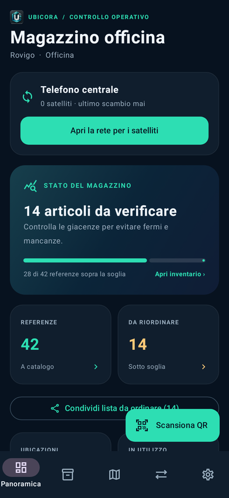
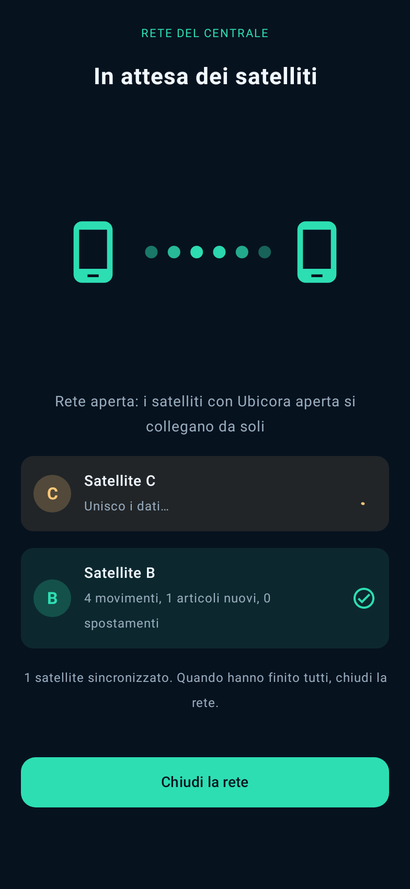

# Ubicora

**Inventario, ubicazioni e mappa del magazzino — sul telefono, senza cloud, anche in squadra.**

[📖 Guida illustrata (PDF)](docs/guida/Ubicora_Guida_4.12.pdf) · [🆕 Novità](docs/CHANGELOG.md) · [⬇️ Installare e aggiornare](#installare-e-aggiornare) · [🌐 Versione Web](web/README.md)

  
  
  
  
  

## Cosa fa

| | Funzione | In breve |
|---|---|---|
| 📦 | **Articoli** | Codici automatici per categoria, unità di misura da menu, foto, scorta minima, preferiti ★, carico/prelievo ±1 con Annulla |
| 📷 | **QR** | Etichette per articoli e strutture, scanner, **prelievo a raffica** (scansiona → quantità → prossimo) |
| 🗺️ | **Mappa** | Pianta in metri: pareti che chiudono le forme da sole, scaffali con ripiani e posizioni, viste a colori, PDF, rilievo AR |
| 👥 | **Lavoro in squadra** | Un telefono **centrale** e più **satelliti**: si sincronizzano da vicini (Bluetooth + Wi-Fi diretto, senza internet) o con file cifrati; **reparti** per operatore |
| 📊 | **Gestione** | Movimenti, prestiti, lista da ordinare da condividere, acquisti, inventari, trasferimenti, manutenzioni, lotti e report (modalità aziendale) |
| 📥 | **Excel** | [Modello anagrafica](docs/Ubicora_Modello_Anagrafica.xlsx) per caricare tutti gli articoli in una volta; esportazione CSV |
| 🧤 | **In officina** | Tema chiaro, modalità guanti (tutto più grande), funziona offline |

## Sicurezza

| Cosa | Come |
|---|---|
| Archivio sul telefono | **Cifrato** con SQLCipher (AES-256); chiave casuale custodita dal portachiavi sicuro di Android (Keystore) |
| Backup e scambi tra telefoni | File cifrati AES-256-GCM, chiave derivata dalla password (PBKDF2, 220.000 passaggi) |
| Accesso | Profili con PIN (PBKDF2 + blocco progressivo), schermate protette dagli screenshot (disattivabile) |
| Collegamento in squadra | QR con **codice usa e getta** valido 10 minuti; password della squadra sigillata nel Keystore |
| Dati | Nessun account, nessun server obbligatorio: tutto resta sul telefono finché non esporti un backup |

## Installare e aggiornare

1. **Actions → Ubicora Stable Signed Update → Run workflow** sul ramo `main`, con il `versionCode` della versione (es. `4120`).
2. A fine esecuzione scarica dall'area *Artifacts* lo zip `ubicora-signed-update-code-…` e installa l'APK che contiene.
3. Gli APK firmati si installano **sopra** la versione esistente, senza perdere dati.

> ⚠️ Non usare gli APK «DEBUG – do not use for updates»: hanno una firma diversa e non aggiornano l'app.
> Prima di un aggiornamento importante fai un **backup completo** (Impostazioni → Esporta backup completo).
> Dettagli: [aggiornare senza disinstallare](docs/AGGIORNAMENTI_APK_SENZA_DISINSTALLARE.md).

## Struttura del progetto

| Cartella | Contenuto |
|---|---|
| `app/` | App Android nativa — Kotlin, Jetpack Compose, SQLite/SQLCipher |
| `web/` | [Ubicora Web](web/README.md): versione per PC nel browser, anche offline, legge il CSV dell'app |
| `server/` | Backend FastAPI/PostgreSQL con OIDC — predisposto, non ancora in uso ([dettagli](server/README.md)) |
| `docs/` | Guida, novità, note tecniche e documenti legali |
| `tests/` | Controlli di struttura in Python; i test dell'app sono in `app/src/test` (Robolectric) e `app/src/androidTest` (emulatore) |

## Sviluppo

- Android Gradle Plugin 8.10, Kotlin 2.1, Java 17, SDK 36 (min 26).
- `./gradlew testDebugUnitTest assembleDebug` — test e APK di prova.
- Ogni pull request verso `main` esegue lint e test ([android-build](.github/workflows/android-build.yml)); l'archivio cifrato è verificato su emulatore ([encrypted-archive](.github/workflows/encrypted-archive.yml)).

## Documentazione

- **Per chi usa l'app:** [guida illustrata 4.12](docs/guida/Ubicora_Guida_4.12.pdf) · [novità versione per versione](docs/CHANGELOG.md)
- **Approfondimenti:** [mappa](docs/PLANIMETRIA_4_1.md) · [gestione aziendale](docs/MANAGER_4_3_GUIDA.md) · [indicatori](docs/MANAGER_INDICATORI_4_6.md) · [pianificazione e tracciabilità](docs/PLANNING_4_6.md) · [server](docs/ENTERPRISE_4_4_SERVER.md)
- **Rilascio:** [criteri beta](docs/BETA_RELEASE_GATE.md) · [checklist commerciale](docs/COMMERCIAL_RELEASE_CHECKLIST.md) · [stato dei test](docs/TEST_REPORT.md)

## Stato e informazioni legali

Ubicora è in **fase di test**: non è certificata né pronta alla distribuzione commerciale, e la registrabilità del marchio va ancora verificata. Identificativo Android: `com.ubicora.app`.

- **Componenti di terze parti:** [THIRD_PARTY_NOTICES.md](THIRD_PARTY_NOTICES.md), [LICENSES/Apache-2.0.txt](LICENSES/Apache-2.0.txt) e, nell'app, «Privacy e licenze». ARCore e Google Nearby seguono le condizioni di Google; SQLCipher la licenza Zetetic (BSD).
- **Privacy:** [bozza di informativa](docs/PRIVACY_POLICY_DRAFT_IT.md), da completare prima di una pubblicazione.
- **Provenienza del codice:** [audit](docs/PROVENANCE_AUDIT.md).

La licenza Apache 2.0 inclusa riguarda solo i componenti di terze parti: nessuna licenza sul codice di Ubicora è concessa implicitamente.
